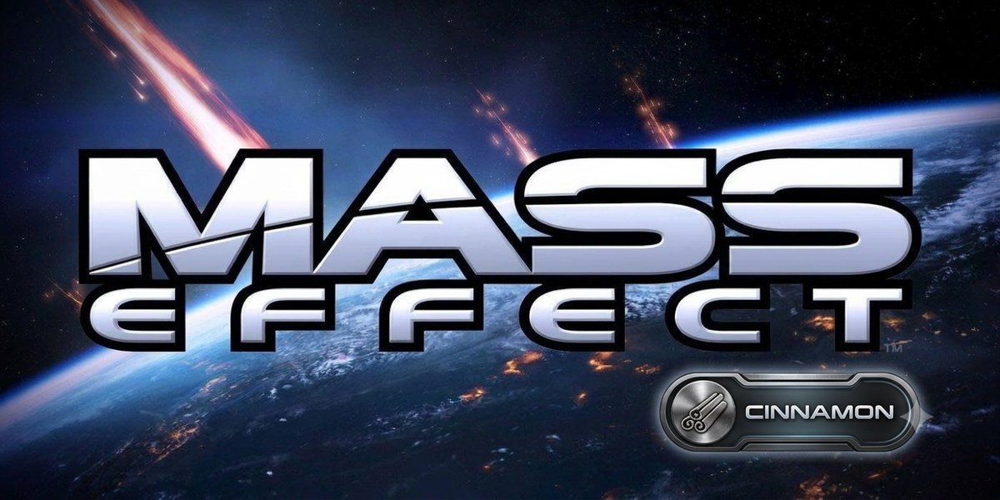

<div align="center">



### BioWare's *Mass Effect* (Xbox 360, 2007), statically recompiled for the Nintendo Switch and tuned for 30 fps at **stock clocks**

[](https://jvankooo.github.io/masseffect-cinnamon/)
[](https://github.com/jvankooo/masseffect-cinnamon/releases)
[](#-install)
[](docs/optimisation.md)
[](LICENSE)
[](https://buymeacoffee.com/jvkt18)

**A performance fork of [masseffect-nx](https://github.com/nebadasSwifty/masseffect-nx) by
[NebadasSwifty](https://github.com/nebadasSwifty)**. All the credit for the port itself goes there.

**[Optimisations](#-the-optimisations)** · **[Gyro aim](#-gyro-aim-assist)** · **[Install](#-install)** ·
**[Build](#%EF%B8%8F-building-from-source)** · **[Controls](#-controls)** · **[Credits](#-credits)**

<br>

<a href="https://buymeacoffee.com/jvkt18"></a>

</div>

---

## ⚡ The optimisations

Every row was found in a console log and measured on a real Switch at **CPU 1224 MHz / GPU 460.8 MHz, handheld, no
overclock**. The full story, with the numbers, is in **[docs/optimisation.md](docs/optimisation.md)**.

<div align="center">

| | Optimisation | What it fixes | Gain |
| :---: | :--- | :--- | :--- |
| 🧱 | **No 2x MSAA tiling** | The game replayed its whole scene once per EDRAM tile | **~3,300 → ~1,500 draws** a frame on the Normandy |
| 🧠 | **No guest depth prepass** | ~430 draws a frame built, parsed and thrown away | heavy views **20-26 → 27-30 fps** |
| 🧵 | **Inline texture updates** | Texture streaming split frames when you turned around | **15 fps bursts on a 180° turn: gone** |
| 🎬 | **Shader prewarm loader** | Vulkan pipelines compiled in the middle of cutscenes | cutscenes **8-13 fps → smooth** |
| 🖼️ | **720x400 + FXAA + FSR** | GPU budget at 460.8 MHz, without stair-stepped edges | **20 % fewer pixels**, clean edges |
| 🌑 | **Cheaper shadows, kept** | 432² shadow maps for every character, even tiny ones | **~⅓ of the shadow pixels** |
| 🌄 | **Small-object culling** | Far rocks, debris and props drawn as specks | fewer outdoor draws *(new, not yet measured)* |
| 🎮 | **Lighter game thread** | VFX budget, corpse cleanup, GC and light-environment updates | fewer main-thread spikes |
| 🔋 | **Official 1600 MHz memory profile** | Cache-bound CPU threads at the default 1331 MHz | free, **not an overclock** |
| 🔦 | **Real flare occlusion** | Lens flares and halos shining through walls and Shepard | **correct picture** |
| 🎞️ | **Motion-blur crop fix** | Black intro cutscenes at 720x400 | **cutscenes render** |

### 📊 Result

10-second profile blocks during gameplay, handheld, stock clocks

| Build | 29-30 fps | 25-29 fps | 20-25 fps | < 20 fps | Mean |
| :--- | :---: | :---: | :---: | :---: | :---: |
| Early Cinnamon build (800x448, before the draw-count work) | 43 % | 30 % | 21 % | 5 % | 26.9 |
| **Cinnamon** (latest measured) | **79 %** | 8 % | 13 % | **0 %** | **28.9** |

</div>

Cutscenes, interiors, dialogue and most exploration run locked at 30. The heaviest crowd and outdoor scenes (the Eden
Prime dig-site camp, the busy Normandy crew deck) can still dip into the low 20s, because all three CPU cores are full
there; small-object culling is aimed at exactly those scenes.

## 🎯 Gyro aim assist

Motion aiming, built into the port's Switch input driver
([`sdk/src/input/switch/switch_input_driver.cpp`](sdk/src/input/switch/switch_input_driver.cpp)):

- **Hold ZL** (aim / zoom) and turn the console or controller: the motion is **added to the right stick**, so the stick
  still does the big turns and the gyro does the fine aim. `input_gyro = 2` keeps it on all the time, `0` turns it off.
- **Works however you hold it.** The turn is the rotation around **gravity** (the six-axis sensor's angular velocity
  projected on a low-passed accelerometer "up"), not around the controller's own axis, so tilting the console does not
  turn Shepard. Pitch is the rotation about the controller's X axis.
- **Precise and steady.** A dead zone (`input_gyro_deadzone`, 1.5°/s) removes hand tremor and sensor drift, light
  smoothing removes jitter, and the first motion past it already jumps over the game's own stick dead zone
  (`input_gyro_min_stick`), so small corrections register.
- **Tunable in game.** **L + R + X** / **L + R + Y** raise and lower the sensitivity by 0.5 (default 3.0: the stick is
  fully pushed at 40°/s). X and Y are hidden from the game while L and R are held. Every attached controller layout
  works (handheld, Pro Controller, Joy-Con pair), and `input_gyro_invert_x` / `_y` flip an axis.

## ✨ Also in Cinnamon

- 🎬 **"PREPARING SHADERS" screen** on the first boot instead of stutter later; every boot after it is quick.
- 🔦 **Lens flares** that fade behind geometry like on the Xbox 360, measured with real GPU occlusion queries.
- 🌑 **Character shadows kept** at lower cost; nothing important was cut to reach 30.
- 🛠️ **Windows build script** (`tools/build_nro.ps1`) next to the Docker build.

## 📦 Install

1. Open the **[installer page](https://jvankooo.github.io/masseffect-cinnamon/)** in Chrome or Edge on your computer.
2. Choose your Xbox 360 disc image (`.iso`) or the extracted disc. The page checks the edition, makes the shaders from
   your disc with WebAssembly and downloads the Cinnamon build from this repository's latest release. **Your game
   files never leave your computer.**
3. Extract the resulting `masseffect-nx.zip` into `sdmc:/switch/` and start it with full memory: hold **R** while
   launching an installed game, or install the NSP launcher the page offers.

## 🛠️ Building from source

> [!IMPORTANT]
> **No game files are included.** The port is made from your **own original Xbox 360 disc image** of *Mass Effect
> (USA, Europe) (En,Es,Pl) (Rev 1)*. The repository contains no game files, and nothing made from the disc may ever be
> committed to it.

You can also build everything yourself from source instead of using the installer:

The full step-by-step guide is in **[docs/building.md](docs/building.md)** (macOS and Linux through Docker; native
Windows in its last section). In short:

```sh
# 0. Get the source
git clone https://github.com/jvankooo/masseffect-cinnamon.git
cd masseffect-cinnamon

# 1. Third-party libraries the repository does not carry
python3 tools/fetch_thirdparty.py

# 2. Your disc: extract the ISO into assets/game_root (check default.xex against docs/editions.md)
python3 tools/extract_iso.py "Mass Effect (USA, Europe) (En,Es,Pl) (Rev 1).iso"

# 3. The code generator, then translate the game's program to C++ (applies the Cinnamon patches too)
tools/build_host.sh
tools/codegen.sh

# 4. The Vulkan driver (Mesa/NVK for the Switch), once: an hour or more
mesa/build_mesa_docker.sh

# 5. The Switch program: out/nx/masseffect-nx.nro
tools/build_nro.sh              # Docker
# Windows without Docker:
# powershell -ExecutionPolicy Bypass -File tools\build_nro.ps1 -MesaSdk <...\opt\devkitpro\portlibs\switch> -Glslang <glslangValidator.exe>

# 6. The shader library from your disc (see docs/building.md, step 7)
shaders/tools/build_extra_tools.sh ue3_shader_scan
find assets/game_root -type f -iname '*.xxx' -print0 | xargs -0 out/tools/ue3_shader_scan run/shaders
cp shaders/runtime_containers/*.bin run/shaders/
ALLOW_FAILURES=1 shaders/tools/build_shader_spirv.sh run/shaders run/shaderlib
```

### 📁 SD card layout

```text
sdmc:/switch/masseffect-nx/
  ├── masseffect-nx.nro               ← out/nx/masseffect-nx.nro
  ├── masseffect.toml                 ← app/masseffect.toml   (the tuned Cinnamon settings)
  ├── masseffect_prewarm_list.bin     ← app/prewarm/masseffect_prewarm_list-en.bin
  ├── masseffect_shaders.mesp         ← run/shaderlib/
  ├── masseffect_shaders.mesp.idx     ← run/shaderlib/
  └── game_root/                      ← your extracted disc (assets/game_root)
```

Start it with full application memory: hold **R** while launching an installed game to open the homebrew menu in
title mode, or use a forwarder set to the 39-bit address space.

> [!TIP]
> The **first boot** shows the *PREPARING SHADERS* screen for a few minutes while it builds the pipeline cache on
> the SD card. Every boot after that is quick.

## 🎮 Controls

<div align="center">

| Switch | Action in Mass Effect | Xbox 360 |
| :--- | :--- | :--- |
| **A** | Interact / Confirm / Take Cover | A |
| **B** | Cancel / Exit / Storm (Sprint) | B |
| **X** | Draw & Holster Weapon / Reload | X |
| **Y** | First Aid (Medi-Gel) | Y |
| **ZR** | Fire Weapon / Vehicle Cannon | RT |
| **ZL** | Target Lock / Zoom / Vehicle Thruster, **+ gyro aiming while held** | LT |
| **R** | Weapon Wheel (Pause Combat) | RB |
| **L** | Biotic & Tech Power Wheel (Pause Combat) | LB |
| **+** | System Menu / Pause | Start |
| **−** | Codex & Journal / Equipment | Back |
| **Left Stick** | Shepard Movement / Mako Steering | Left Stick |
| **Right Stick** | Camera Look / Turret Aim | Right Stick |
| **L3** | Toggle Crouch | Left Stick Click |
| **R3** | Scope Zoom Toggle | Right Stick Click |
| **D-Pad** | Squad Orders (Attack, Move, Regroup) | D-Pad |

</div>

### 🎯 Gyro controls

<div align="center">

| Input | Effect |
| :--- | :--- |
| Hold **ZL** and move the console / controller | Fine aim with motion, added to the right stick |
| **L + R + X** | Gyro sensitivity +0.5 |
| **L + R + Y** | Gyro sensitivity −0.5 |

</div>

The settings live in `masseffect.toml`:
- `input_gyro`: 0 = off, 1 = while ZL is held (default), 2 = always.
- `input_gyro_sensitivity`: default 3.0.
- `input_gyro_invert_x` and `input_gyro_invert_y`: invert an axis.
- `input_gyro_deadzone`: hand-tremor filter.

Turning follows the real horizontal axis whichever way you hold the console, because the yaw is measured around
gravity.

Other options: `input_xbox_layout = true` for the Xbox button positions, `input_rumble = true` for rumble.
**L + R + Up / Right / Down / Left** open the SDK's debug overlay, settings, log console and achievements.

## ⚙️ Tuning

Every key in [`app/masseffect.toml`](app/masseffect.toml) is commented. The Cinnamon ones you may want to touch:

<div align="center">

| Key | Default | What it does |
| :--- | :---: | :--- |
| `masseffect_cull_small_factor` | `100` | Small-object draw distance (lower = faster, more pop-in; `0` = off) |
| `input_gyro_sensitivity` | `3.0` | Gyro aiming speed |
| `masseffect_native_output_fxaa_subpix` | `0.5` | FXAA softness (0 = sharpest) |
| `masseffect_flare_occlusion` | `true` | Real occlusion for lens flares and halos |
| `masseffect_guest_skip_prepass` | `true` | The game does not build its depth prepass |
| `masseffect_scene_width` / `_height` | `720` / `400` | Internal resolution (keep the width equal to `video_mode_width`) |

</div>

> [!WARNING]
> Do not enable `masseffect_cpu_boost`: while it is on, the system throttles the GPU and the game falls to a few fps.
> Cinnamon is tuned for, and measured at, **stock clocks**; overclocking is neither needed nor recommended.

## 📚 Documentation

- **[docs/optimisation.md](docs/optimisation.md)**: how Cinnamon reaches 30 fps at stock clocks.
- [docs/building.md](docs/building.md): the full build, step by step.
- [docs/best-config.md](docs/best-config.md): every console run behind the shipped settings.
- [docs/README.md](docs/README.md): the upstream guide to how the whole port works (start here to learn the internals).
- [docs/known-issues.md](docs/known-issues.md): what is not finished or not proven.

## ☕ Support

Cinnamon took a lot of late nights of console logs and frame-by-frame profiling. If it made Mass Effect playable on
your Switch, a coffee keeps the next round of optimisations coming:

<a href="https://buymeacoffee.com/jvkt18"></a>

## 💛 Credits

- **[NebadasSwifty](https://github.com/nebadasSwifty)**: author of **[masseffect-nx](https://github.com/nebadasSwifty/masseffect-nx)**,
  the Mass Effect Switch port this fork is built on: the recompilation, the native Vulkan renderer, the EDRAM
  emulation, the shader pipeline, the Switch platform layer and nearly all of the documentation. Cinnamon is a
  modified version of that work (see [LICENSE](LICENSE)).
- **BioWare and Electronic Arts**: creators of Mass Effect. This is an unofficial, non-commercial fan project with no
  affiliation.
- **[StevensND](https://github.com/StevensND)**: [NFSMW-NX](https://github.com/StevensND/NFSMW-NX), pioneering work on
  statically recompiled Xbox 360 games on the Switch (not affiliated with this project).
- **[madelrandel-blip](https://github.com/madelrandel-blip/NFSMW-Recompiled)**: NFSMW Recompiled, where the upstream
  port started.
- **[Tom Clay](https://github.com/rexglue/rexglue-sdk)**: the ReXGlue SDK, built on the research of the
  **[Xenia](https://xenia.jp)** team.
- **[hedge-dev](https://github.com/hedge-dev/XenosRecomp)**: XenosRecomp, the Xenos shader translator.
- **[danfromtico](https://github.com/danfromtico/mesa-switch)** and **[NaGaa95](https://github.com/NaGaa95/mesa-switch)**:
  mesa-switch (Mesa, NVK and NAK on Horizon OS).
- **[devkitPro](https://devkitpro.org)** and **[switchbrew](https://github.com/switchbrew/libnx)**: devkitA64 and libnx.
- All third-party libraries listed in [THIRD_PARTY_NOTICES.md](THIRD_PARTY_NOTICES.md).

## ⚖️ Legal

No affiliation with Electronic Arts or BioWare. "Mass Effect" is a trademark of Electronic Arts Inc. This repository
contains **no assets or program code from the original game**: the installer or a source build makes the package from your own legally obtained disc.
Running homebrew requires custom firmware, which violates Nintendo's terms of service and can get a console banned.
That is your call.

Copyright (c) 2026 NebadasSwifty (the original port), with modifications for Mass Effect Cinnamon (2026). Source code
under the **GPL-3.0** ([LICENSE](LICENSE)), as inherited from the original project. The SDK changes are under the SDK's
BSD-3-Clause license, the shader translator and Mesa changes under MIT ([THIRD_PARTY_NOTICES.md](THIRD_PARTY_NOTICES.md)).
